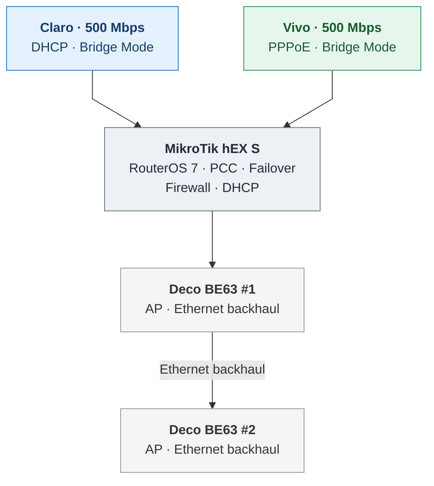
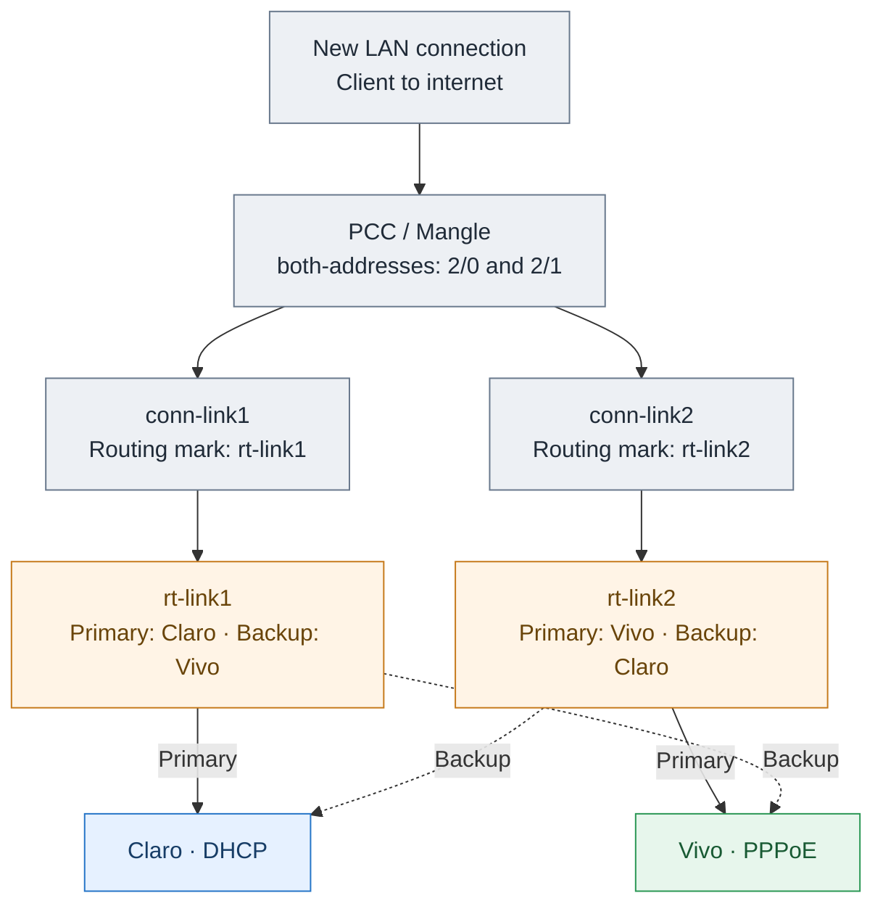

# MikroTik RouterOS 7 — Dual-WAN PCC, Failover & Monitoring

**A tested home-network case study: simple route-based failover, consistent PCC routing, and independent ISP monitoring.**

> **Pre-publication review.** Configuration examples are installation-specific and must be adapted before use.

## Network at a glance

| Component | Configuration |
| --- | --- |
| Router | MikroTik hEX S · RouterOS 7.24.5 |
| WAN 1 | Claro · 500 Mbps · DHCP · ISP modem in bridge mode |
| WAN 2 | Vivo · 500 Mbps · PPPoE · ISP modem in bridge mode |
| Wi-Fi | Two TP-Link Deco BE63 · AP mode · Ethernet backhaul |
| LAN services | MikroTik handles routing, DHCP, DNS, NAT, firewall and WAN policies; Decos manage Wi-Fi |

## Network topology

## Design: keep failover simple

We initially explored scripts that modified routes during ISP failures. Those iterations were not sufficiently reliable for this installation, so we chose **native routing tables, route priorities and gateway/interface availability** instead. **No custom script switches production routes.**

The **cross-backup design** is straightforward: each PCC routing table prefers one ISP, with the other ISP configured as its backup using route distances.

PCC uses conventional Mangle connection and routing marks with the **`both-addresses:2/0` and `both-addresses:2/1`** classifier for nominal 50/50 distribution. We chose this less granular classifier for a relatively small home: connections between the same client and destination IP tend to stay on the same WAN. That can reduce IP-consistency problems with banking and authentication services, but does not guarantee complete application affinity, 50/50 throughput or bandwidth bonding.

The Claro DHCP client manages DHCP-learned routes, avoiding manual updates when its gateway changes.

### PCC and cross-backup routing

## Monitoring and logging — separate from routing

Two external targets per ISP are probed via independent monitoring tables. Four Netwatch probes feed an aggregator that logs DOWN only when **both targets** are DOWN in **two consecutive scheduler observations**; UP is logged when **either target** is UP in two consecutive observations. The scheduler runs every 30 seconds, but detection latency is not a fixed 60 seconds.

Two distinct sets of rotating text logs are retained on a USB drive:

- **WAN outages:** confirmed ISP DOWN/UP and approximate outage durations, in `wan-outages`.
- **Router events:** interface, DHCP and PPPoE events, in `router-events`, with `!debug` filters to reduce noise.

**Neither log nor the aggregator changes routing.** USB storage was chosen for simple persistent retention; logs could instead use internal storage, subject to space and flash-write considerations. The `/disk` hardware/partition declaration is intentionally omitted from the shared script: configure the USB volume and adjust the log paths for your router.

## Validation and known limits

Controlled monitor-target blackholes and physical cable disconnect/reconnect tests confirmed probe aggregation, route fallback and log events. A failure farther upstream with the ISP gateway still reachable may be detected and logged **without automatic traffic failover**. Existing sessions may not survive a public-IP change.

## Files

- [Architecture](docs/architecture.md)
- [Testing](docs/testing-results.md)
- [Limitations](docs/limitations.md)
- [Related projects](docs/related-projects.md)
- [Forum introduction draft](docs/forum-article-short.md)

- [Sanitized single-file RouterOS 7 reference](config/DualWAN-RouterOS7-SANITIZED-REVIEW-ONLY.rsc)

The `.rsc` matches the approved anonymized review version. It is a **sectioned reference, not a drop-in installer**. In particular, USB partition initialization (`/disk`) is intentionally omitted.

## Background and acknowledgments

This started in 2022, when seven or eight family members were often working from home and a second ISP became necessary. A [Redes Brasil](https://www.redesbrasil.com) MikroTik course in June 2024 substantially improved my RouterOS skills. Later iterations used suggestions from ChatGPT, Claude and Grok; in this project ChatGPT proved the most useful collaborator, while every meaningful change still required manual checking and controlled tests.

## Final Thoughts

The journey may have been longer than expected, with plenty of trial and error along the way, but the outcome has been incredibly rewarding.

I'm sharing this project because I know I wouldn't have made it this far without the knowledge, experiences, and solutions that others generously shared before me.

**This is my small contribution to giving something back to the community that helped me get here.**
