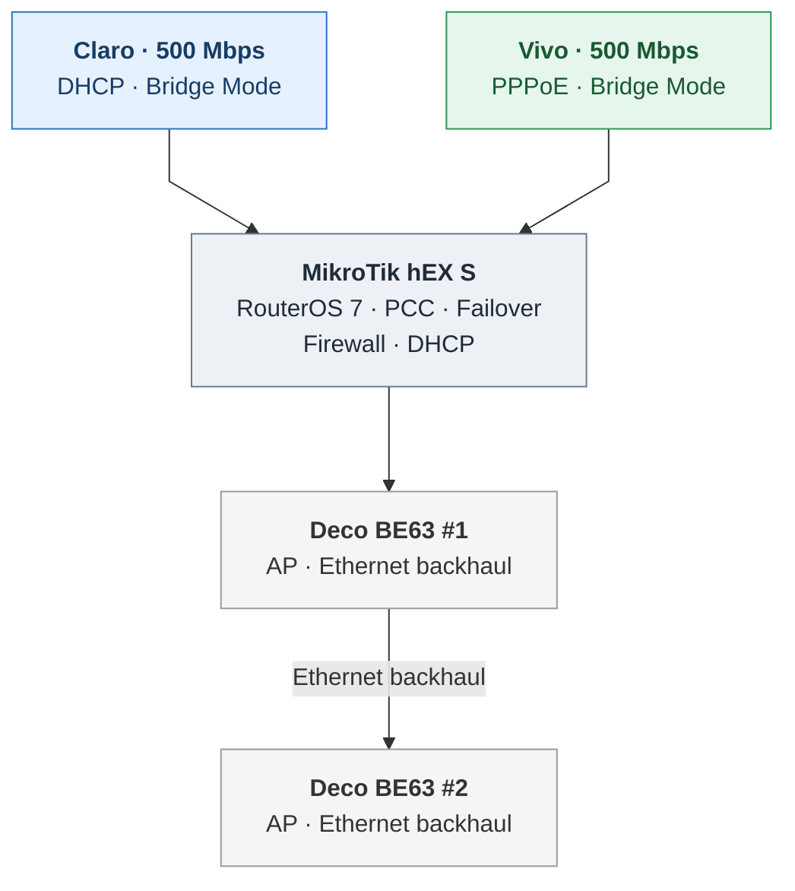
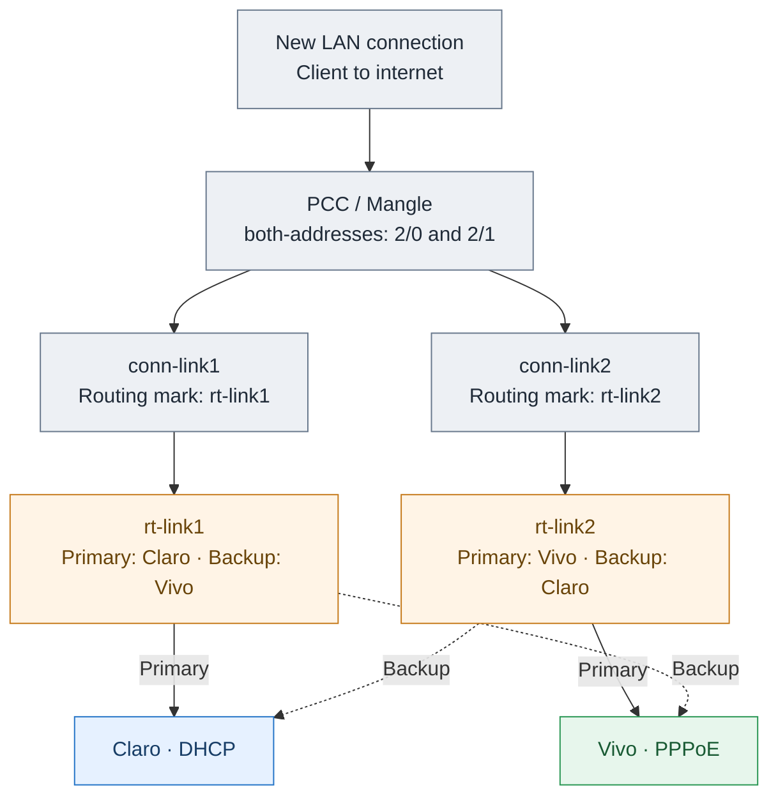
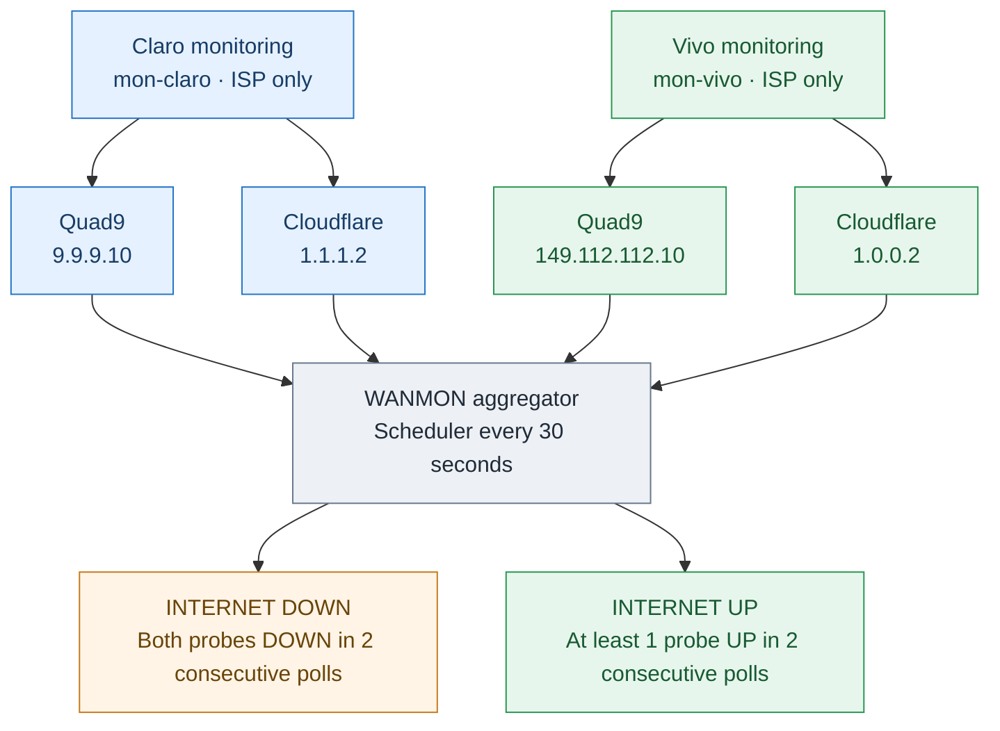
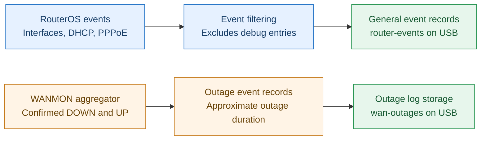

# Architecture

## Physical / logical network

## PCC and Mangle

The router uses a conventional `both-addresses:2/0` / `both-addresses:2/1` classifier and connection/routing marks to direct traffic to `rt-link1` and `rt-link2`. The less-granular hash keeps the same source/destination IP pair on one WAN under normal conditions, which can help avoid IP-inconsistency problems with security-sensitive services, but does not guarantee 50/50 bandwidth use or complete application affinity.

## Native cross-backup failover

Each policy routing table prioritizes its corresponding ISP and has a secondary route over the other ISP. Route distances determine preference; route availability determines fallback. **No monitoring script modifies production routes.** The DHCP-managed Claro routes adapt automatically to gateway changes.

## Independent ISP reachability monitoring

Four Netwatch probes test two external public IP destinations for each ISP. Dedicated `mon-claro` and `mon-vivo` routing tables, plus destination-specific `lookup-only-in-table` rules, keep each router-originated test on its ISP without spillover.

The `wanmon-aggregator` scheduler runs every 30 seconds. Both targets must be DOWN on two consecutive polls for an outage; either target UP on two polls signals recovery. Probe/scheduler timing is not synchronized, so logged durations are approximations, not exact outage measurements.

## Event and outage logging

## Outage records

Confirmed WANMON DOWN/UP events, with approximate duration, go to rotating text files on USB at `usb1-part1/wan-outages`.

## General router events

Interface, DHCP and PPPoE events are written separately at `usb1-part1/router-events`. Routine topic selections exclude debug output using `!debug`. USB files are a simple persistence option; alternatively, internal flash can be used with appropriate capacity/write-cycle planning, while RAM logs are volatile.

**Neither event log has any role in route selection or failover.** The storage device and `/disk` partition declaration are environment-specific; the public reference does not configure USB partitions.

## Core limitation

An upstream internet outage may be detected by Netwatch while the ISP gateway stays reachable. In that case production traffic is **not guaranteed to fail over** because WANMON does not control routes. Loss of an interface or unavailable preferred route was separately tested.
