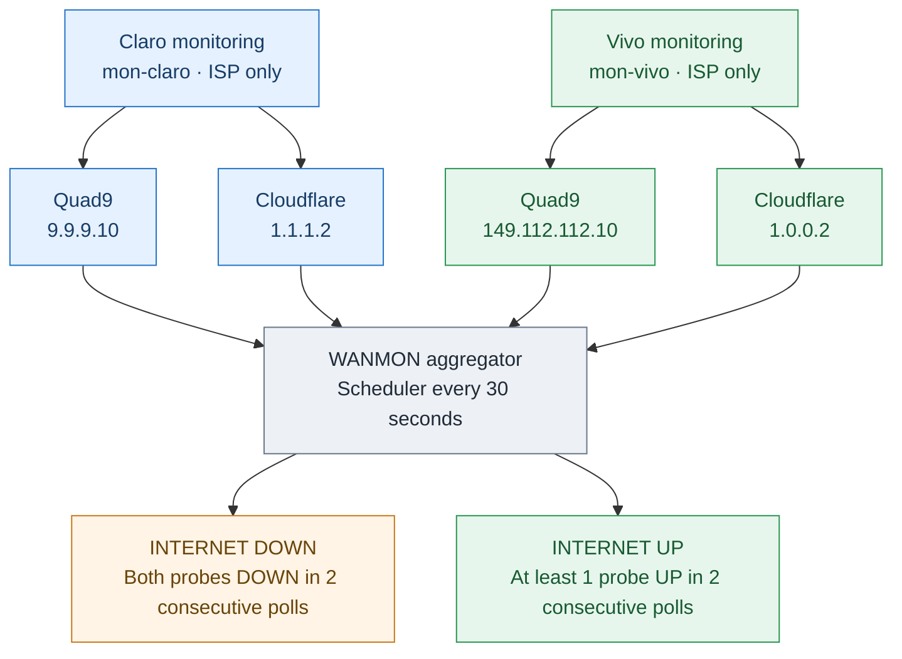

# Diagram 3 — Independent ISP Monitoring (preview)

**Review only.** Monitoring is separate from production failover routing. Four router-originated Netwatch probes are constrained to their respective ISP through dedicated monitoring routing tables and `lookup-only-in-table` rules.

## Notes

- **Purpose:** Independent ISP monitoring provides observability and supports further troubleshooting by recording connectivity changes and helping distinguish ISP outages from local network events.
- Each ISP has **two Netwatch targets** with a 30-second probe interval and 2-second timeout.
- Four specific routing rules pin the targets to `mon-claro` or `mon-vivo`; the monitoring tables have **no other-ISP fallback**.
- The aggregator reads all four states every 30 seconds, independently evaluating each ISP. The DOWN/UP conditions shown in the shared diagram apply **per ISP**, not across both ISPs combined.
- DOWN requires **both** targets DOWN in two consecutive scheduler readings. UP requires **at least one** target UP in two consecutive readings.
- The aggregator writes log events but **does not alter routes**. Outage log storage is documented separately in Diagram 4.
