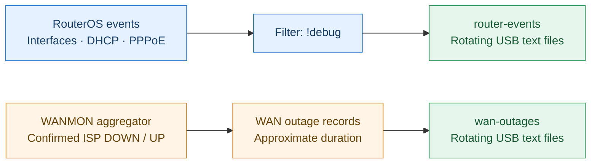

# Diagram 4 — Router Events & WAN Outage Logs (horizontal, equal-width preview)

**Purpose: Pure observability and troubleshooting.**

Two independent, left-to-right logging paths. Neither affects routing or failover.

## Notes

- **General events:** interface, DHCP and PPPoE messages with `!debug` exclusions; stored under `usb1-part1/router-events`.
- **WAN outages:** WANMON's confirmed DOWN/UP events and approximate durations; stored under `usb1-part1/wan-outages`.
- USB is a convenient destination for persistent rotating text logs; internal storage is possible if capacity and write endurance allow.
- **Purpose: Pure observability and troubleshooting.** Neither logging stream changes routing or failover.
