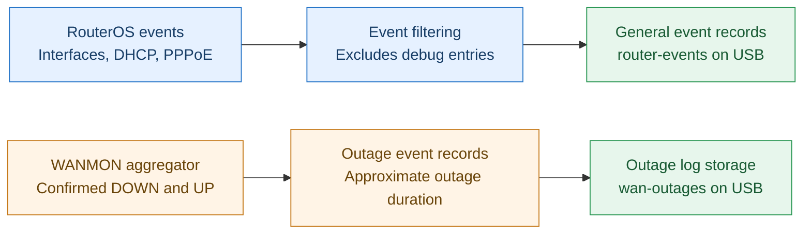

# Diagram 4 — Router Events & WAN Outage Logs (clean horizontal preview)

**Purpose: Pure observability and troubleshooting.**

This version removes forced minimum-width and SVG-label settings, which caused off-center labels in GitHub. All nodes have two text lines, and Mermaid sizes them naturally.

## Notes

- **General events:** Interface, DHCP and PPPoE messages with `!debug` exclusions, stored under `usb1-part1/router-events`.
- **WAN outages:** Confirmed WANMON DOWN/UP events and approximate durations, stored under `usb1-part1/wan-outages`.
- USB is a simple destination for persistent rotating text logs; other local storage may be used where suitable.
- **Purpose: Pure observability and troubleshooting.** Logging does not modify routes or affect failover.
