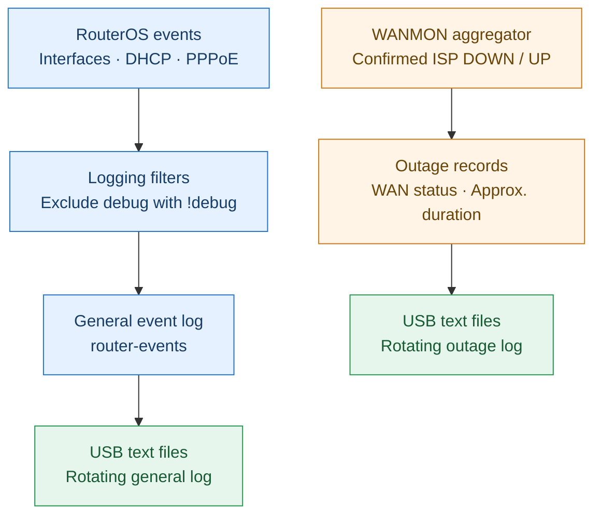

# Diagram 4 — Router Events & WAN Outage Logs (preview)

**Purpose: Pure observability and troubleshooting.**

The two logging flows are independent. Neither log controls route selection or failover.

## Notes

- **General events:** RouterOS interface, DHCP, and PPPoE logs with `!debug` topic exclusions, stored as rotating text files under `usb1-part1/router-events`.
- **WAN outage records:** WANMON writes confirmed ISP DOWN/UP events and approximate durations to rotating text files under `usb1-part1/wan-outages`.
- **Storage:** USB is a simple persistence choice, not a requirement of monitoring or failover. A suitable internal disk location can be used instead.
- **Purpose: Pure observability and troubleshooting.** These records do not affect routing, Mangle, or failover.
