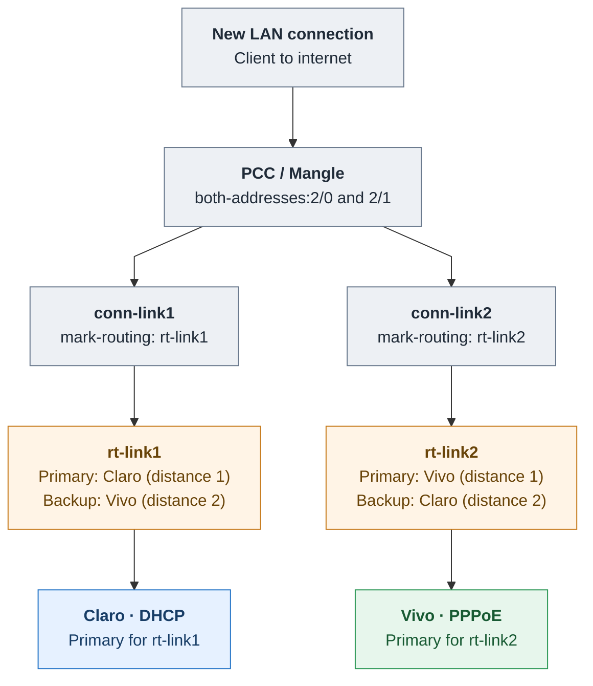

# Diagram 2 — PCC, Mangle & Cross-Backup Failover (v2 preview)

**Review only.** The backup relationship is expressed inside each routing table to avoid crossing arrows and uneven auto-layout.

**Cross-backup:** `rt-link1` prefers Claro and falls back to Vivo; `rt-link2` prefers Vivo and falls back to Claro. Native route distances determine preference. Mangle performs ordinary PCC classification; **no script switches routes**.

**Limitation:** an external upstream failure may be logged by Netwatch without triggering route fallback if the preferred route remains available.
