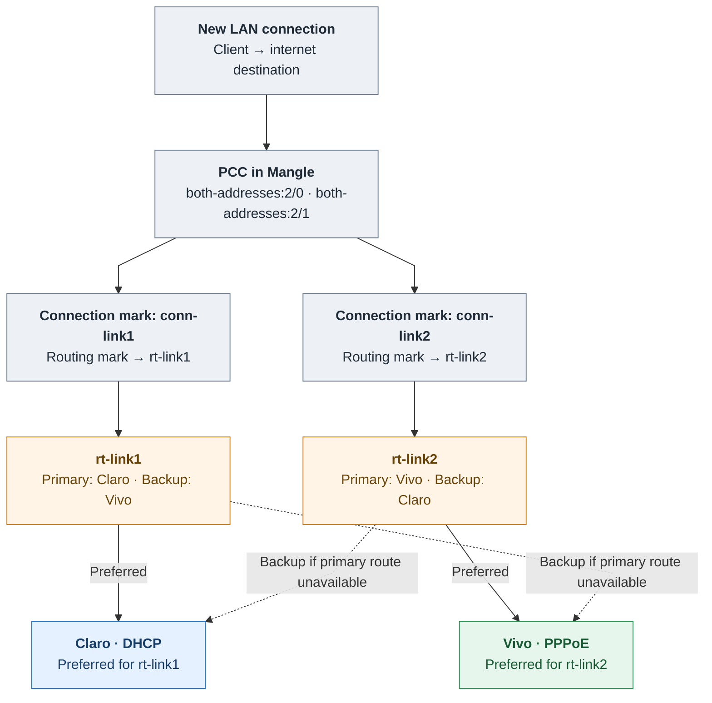

# Diagram 2 — PCC, Mangle & Cross-Backup Failover (review)

**Visual preview only.** This describes routing logic for LAN-originated traffic. It does not depict Netwatch or logging.

**Reading the diagram:** Mangle marks connections and selects the relevant policy routing table; each table has a preferred ISP and the other as a backup through route distances. A backup route is selected when the preferred route becomes unavailable. No custom failover script changes routes.

**Known limitation:** external reachability loss alone, while a primary gateway/route stays available, does not necessarily switch traffic to the other ISP.
