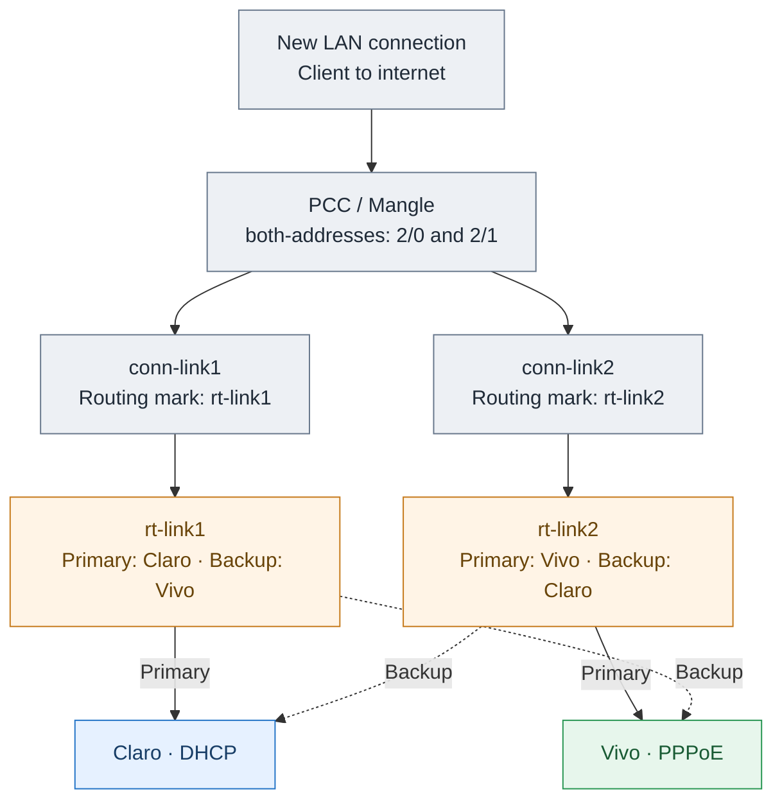

# Diagram 2 — PCC, Mangle & Cross-Backup Failover (v3 preview)

**Review only.** Restores the original crossed-backup flow. Labels now use plain Mermaid text with explicit line breaks, without HTML markup or minimum-node-width overrides, to diagnose GitHub's misaligned text.

**How it works:** PCC/Mangle classifies connections into policy routing tables. Each table prefers one ISP, and the other ISP is its backup when the preferred route is unavailable. Netwatch and logs do not modify routes.
