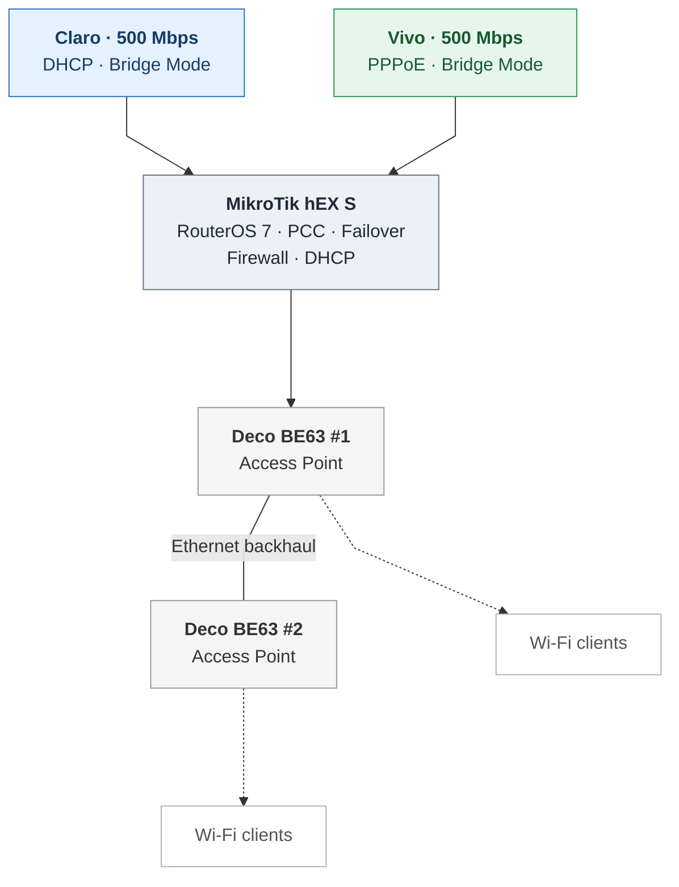

# Mermaid topology — rendering test v6

**Visual test only.** Side-by-side Deco access points with a labeled Ethernet backhaul and Wi-Fi clients beneath each AP.

Note: GitHub's Mermaid layout engine may adjust positions depending on subgraph constraints. Dashed lines represent wireless client associations.
