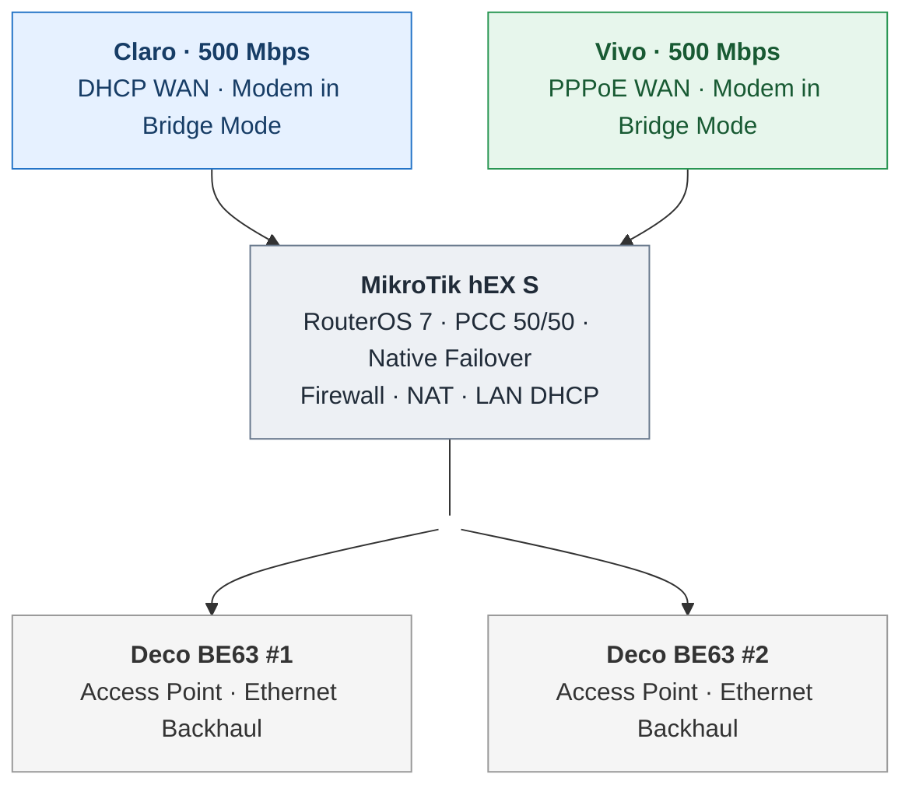

# Mermaid topology — rendering test v3

**Review only:** natural wider boxes using meaningful labels, without HTML padding tricks. GitHub controls Mermaid text metrics.

Note: GitHub did not honor the prior subtitle-size approach. This test emphasizes reliable rendering and naturally wider nodes.
