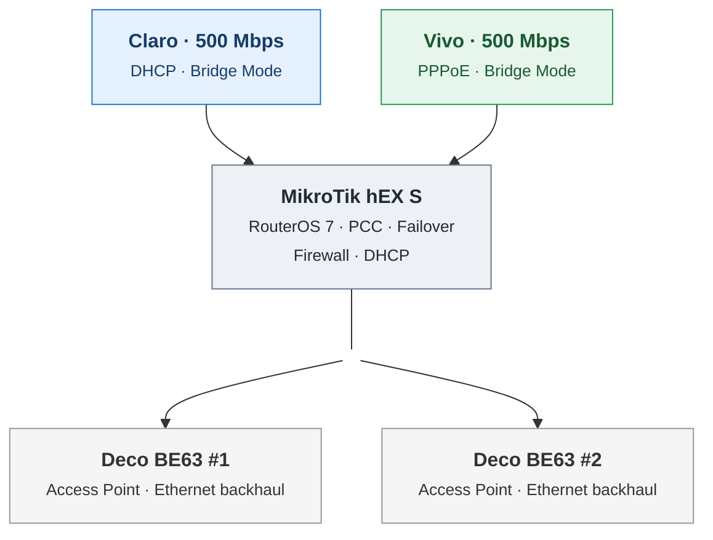

# Mermaid topology — rendering test

This is a **visual test only**. It does not replace the approved architecture or README.

**Review checks:** The heading should be bold, the second line smaller, with Claro and Vivo above the MikroTik and two Deco APs below.
