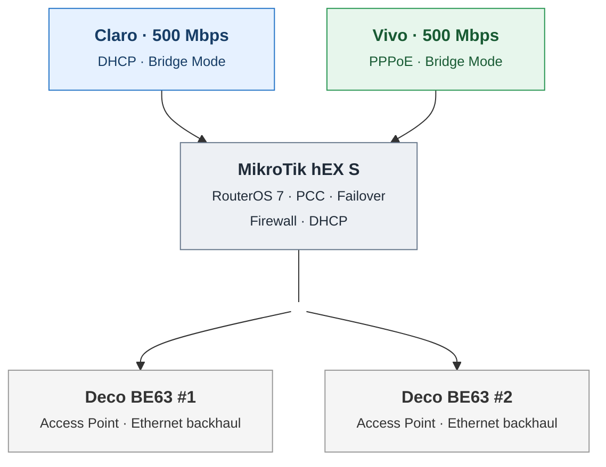

# Mermaid topology — rendering test v2

This is a **visual test only**. It does not replace the approved architecture or README.

GitHub rendered bold headings, but ignored `<small>`. This version tests `` for subtitles and nonbreaking-space padding to make the rectangles wider.

If GitHub also ignores ``, we should avoid fragile HTML-size tricks and use consistent node fonts, keeping the subtitle concise.
