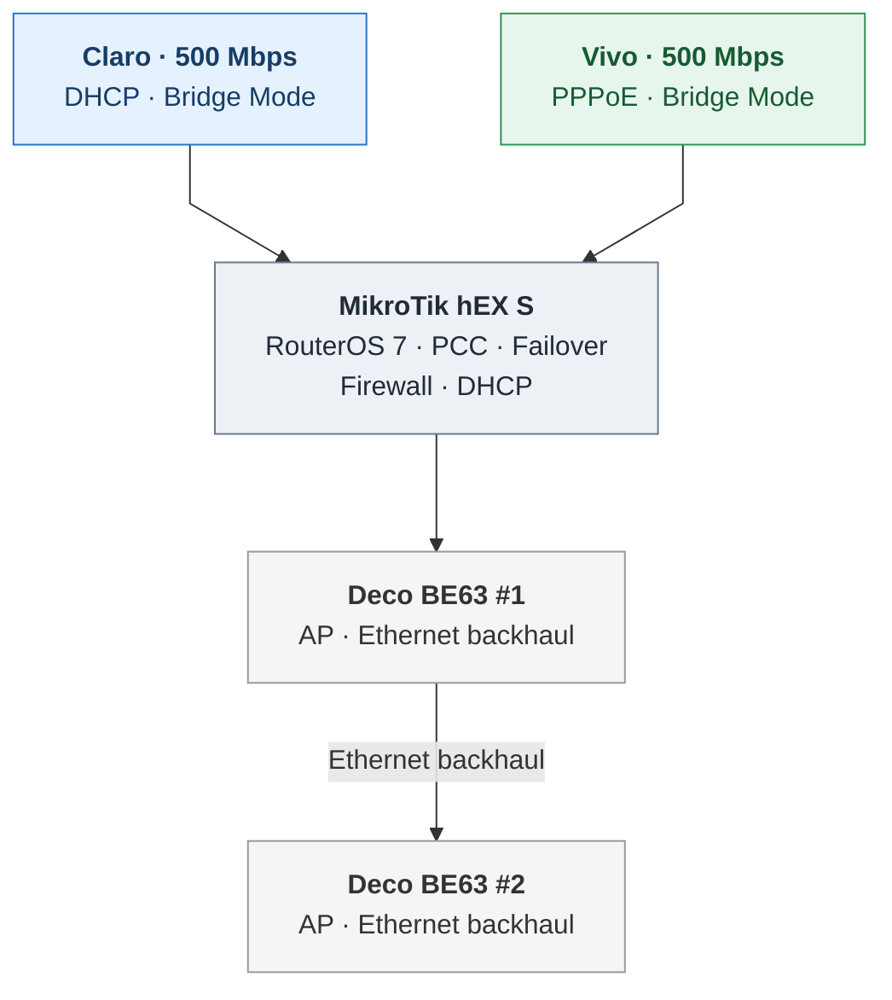

# Mermaid topology — rendering test v5

This version tests a chained Deco layout: MikroTik → Deco BE63 #1 → Deco BE63 #2, with the second link labeled **Ethernet backhaul**. Wide node settings are retained.

Expected: wide horizontal rectangles without padding text hacks. If unchanged, GitHub's bundled Mermaid likely does not apply the config directive, and a small SVG exported from the same diagram may be more reliable.
