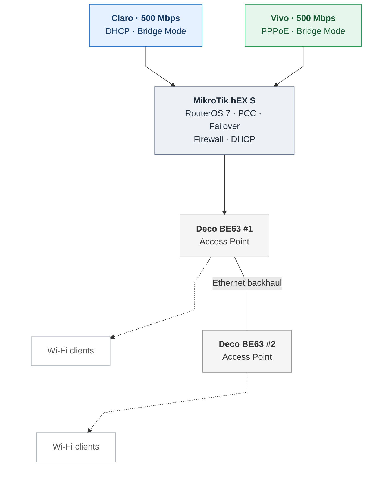

# Mermaid topology — rendering test v7

**Visual test only.** The Deco units are grouped inside a left-to-right subgraph; the backhaul connects them horizontally, while wireless clients are shown in a separate row below.

**Layout caveat:** GitHub Mermaid auto-layout may still override horizontal subgraph direction when it has external links. If that happens, we should use a tiny SVG for exact geometry rather than promise that Mermaid can enforce it.
